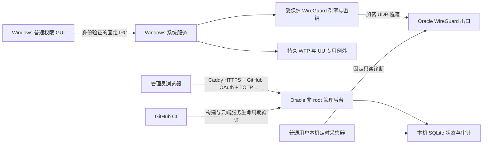

# Oracle Proxy 产品进展与交付约定

核查日期：2026-10-20（Asia/Shanghai）。Windows 源码核查基线：`255123f9ae5bc6adbc1bbdb635a28638061e59da`。

## 结论

项目已有可复用的独立 WireGuard 引擎、Windows GUI、LocalSystem 管理服务、安全边界和大量云端实验。
目前尚未达到「可替换 FlClash 的完整 Windows VPN 产品」状态。
GitHub 没有正式 Release。当前可下载的 Windows R114 是未签名实验便携包，
不能以既有云端实验替代生产防泄漏、开机恢复、UU 连续性或端到端公网出口验收。

按用户最新要求，管理后台已改为 Oracle 自托管，不再使用 Cloudflare Zero Trust、D1 或 Workers，
也不要求绑定银行卡。采用 GitHub OAuth/PKCE + 验证器 TOTP、SQLite、普通用户 systemd 服务和 Caddy HTTPS。
域名继续使用 `vpn-admin.morandi.dpdns.org`，Cloudflare 仅承担已有的 DNS 托管。
PR #146 已合并，后台已实际安装到 Oracle，并通过公网 HTTPS 登录页与未登录接口隔离检查。
用户已确认可以正常登录并看到界面。最终交付必须同时包含独立 Windows 便携客户端安装包，
以及能够管理用户、设备、配额、有效期和出站用量的服务器网页后台。
PR #147 已增加并部署实际监管服务；仅登录成功不作为管理产品的完成条件。

## 用户已确认

- 主控 Windows 11 x64；受控 Windows 10 x64。
- 需要兼容网易 UU 远程，具备本地可恢复的测试电脑。
- 优先在云端做完所有可自动化测试，实机只做无法由云端证明的最终验收。
- Cloudflare 已托管 `morandi.dpdns.org`，账号使用 GitHub 登录。
- 拟用后台域名 `vpn-admin.morandi.dpdns.org`，管理员邮箱 `morandi@nuaa.edu.cn`。
- Oracle 未升级为按量付费，只有这一台实例；本月历史用量和实际账期仍须核对。

Cloudflare 账号登录与产品后台登录相互独立；后台改用 GitHub OAuth，默认允许 GitHub 数字账号 ID `204281968`（Morandi-official），
并要求验证器动态码。邮箱不作为授权依据。

## 从源码与日志得到的实际进展

| 模块 | 已存在的实现/证据 | 尚缺的最终条件 |
| --- | --- | --- |
| Windows 便携 GUI | R114 自包含 x64 程序、离线 X25519 密钥生成、集成 tunnel.dll 与签名 WireGuardNT DLL | FlClash 风格完整界面、延迟/流量真实遥测、稳定用户连接流程 |
| 独立 WireGuard | `wg-alpha/EmbeddedWireGuardBridge.cs` 集成官方 MIT 隧道库，日常不依赖官方 GUI | 与产品级认证 IPC、持久保护、密钥存储和升级机制整合 |
| 系统服务 | `manager` 有身份验证、固定动词、LocalSystem 与多个 CI 安全实验 | 默认生产内核仍是 `UnavailableProductionKernel`，不能用开关绕过 |
| 防泄漏 | WFP IPv4/IPv6、TCP/UDP/DNS、崩溃与恢复的多项隔离实验 | 持久/开机保护、多网卡、真实重启、独立抓包及完整状态机整体验收 |
| UU | 有连续性证据门禁 | 网易 UU 在两种 Windows 上的真实长连接、重连和例外策略验收 |
| Oracle | 已部署只读诊断和独立限权控制器，真实 Peer/握手与持久用量账本；用户限额/到期/禁用和可选全局出站保护 | OCI 官方账单对账、IPv6 公网出口能力核实 |
| 网页后台 | HTTPS、GitHub/TOTP、用户/设备编辑、Peer 新建/绑定、共享月配额/有效期、预算配置与审计；本人已确认登录成功 | 官方用量同步、设备单独撤销与端口配置、最终 Windows 注册/状态联动 |
| 安装和升级 | 部分生命周期与回滚实验、来源校验 | 发布者签名、受保护服务安装、升级事务、卸载/重启恢复与密钥迁移 |

Oracle 部署实证：[Actions 39415011683](https://github.com/Morandi-official/Oracle-Proxy-Infrastructure/actions/runs/39415011683)。
日志为 `deploy-agent`，包含 `AGENT_DEPLOY=OK`、上述三项服务诊断和 `PRODUCTION_NETWORK_CHANGED=NO`。
这是 2026-10-20 19:27 左右的历史观测，不代表阅读本文时仍在线。

Windows 最近成功 R114 构建：
[Actions 39218330880](https://github.com/Morandi-official/Oracle-Proxy-Infrastructure/actions/runs/39218330880)，
源码 `464ad5cd79ccd6c2ff7df8fe98ee075479141120`。
[下载实验便携包](https://github.com/Morandi-official/Oracle-Proxy-Infrastructure/actions/runs/39218330880/artifacts/12169974965)。
Artifact 名称 `OracleProxy-R114-Offline-Keys-Single-Extraction-UNSIGNED`；
72,167,834 字节；归档元数据 SHA256 为
`e066904b08dfaed56f78f574250a7c2e0957aad6dcf11895bc4bb579d41cf3f9`。
该哈希来自 GitHub 元数据，本次未独立下载全部归档并逐字节复核。
按当前 GitHub 元数据将于 2026-10-26 15:50（中国时间）过期，届时应重新构建，不能当永久下载地址。

## 最终产品架构

Windows GUI 只发送固定动作与配置标识；服务从受保护存储读取配置和密钥，
不接收 GUI 提供的任意命令、脚本、服务名或文件路径。服务端管理面不承载 VPN 数据。
Windows 的 WireGuard Endpoint 直达 Oracle；管理后台 HTTPS 和 VPN UDP 为独立入口。

### 流量与保护约定

1. 日常连接由普通权限 GUI 操作，首次安装服务/驱动和卸载需要 UAC。
   「便携包」是分发形式，不代表系统 VPN 可以完全免安装或免提权。
2. 安全模式下先建立独立于 GUI 生存期的 WFP 防护，再启动隧道；握手和探测成功后显示已连接。
   异常断开保持防护，不能把超时自动解释为允许直连。
3. 显式断开与故障分开：界面需要明确选择「断开且继续阻断」或「关闭保护并恢复直连」。
   服务仅在确认本产品隧道已停止、路由/DNS 已恢复后执行后者。
4. TCP、UDP、IPv4、IPv6 和系统 DNS 均需覆盖，含多网卡、热点、睡眠恢复、DHCP 和网卡变化。
   Oracle IPv6 公网出口未经验证；若不可用，必须阻断 IPv6 防止泄漏，并明确不宣称已支持 IPv6 出口。
5. UU 为明确的直连例外。应根据实际签名程序、子进程及 relay/直连行为制定规则，
   不能通过宽泛 IP 或任意应用直连放行。其直连是声明的产品策略。
6. Windows 私钥在本机生成、由 SYSTEM 受保护存储持有，不上传后台。
   R114 当前是受 ACL 限制的明文测试私钥，不能冒充最终的服务端密钥保护机制。

## 后台当前交付范围

目录 `server/admin-oracle/` 是可以构建和注册为系统服务的 Django 应用，含真实接口和中文界面。
SQLite 替代 D1；本机每分钟定时采集替代 GitHub→Cloudflare 公网 HMAC 上报。
默认不展示模拟在线设备或流量；无报告显示未知，报告超过 180 秒显示过期。
管理员现在可以创建/编辑用户、设置共享月配额和到期时间、禁用/恢复用户、绑定已有 Peer，
或提交客户端公钥新建 Peer。独立控制服务的 root-only SQLite 保留按用户/设备的月度账本、
物理 VNIC 出站增量和策略审计；网页通过固定 Unix socket RPC 操作，不获得任意 root 命令能力。
配额/到期/禁用同时作用于该用户的纳管设备；内核短租约覆盖 IPv4/IPv6 和已建立连接。

Oracle 公开每月首 10 TB 出站免费，但官方数据可能延迟，且本机计数不等于账单。
未知的账期历史不会被置零；首次采集时余额显示未知。管理员核对截至当前的用量基线后，
后台用基线加实时 VNIC TX 增量估算剩余，并扣除可配置安全余量作为 VPN 可用预算。
总量保护默认关闭，明确启用后，未知/缺口/到阈值即阻断所有 VPN Peer；HTTPS/公网 SSH 保留。
仍需接入 OCI 官方用量 API，不能承诺零超额。详细边界与操作见 [CONTROL.md](../server/admin-oracle/CONTROL.md)。

身份验证使用成熟的 django-allauth：GitHub OAuth 状态校验及 PKCE、数字 UID 白名单、
强制 TOTP，校验完整登录会话中的 GitHub 与 MFA 记录。绑定验证器不等同完成 MFA 登录。
拒绝本地密码认证、注册和密码重置。动态码防重放/限速缓存保存在共享数据库，
TOTP 秘密用独立 Fernet 密钥加密；主机配置仅 root 可读，应用通过 systemd 获取必要环境变量。

部署指南和免费的 GitHub OAuth App 设置见
[Oracle 管理后台 README](../server/admin-oracle/README.md)。
新 CI 覆盖 Python 3.11/3.12，以及一次性 Linux 主机上真实 systemd 的启动、升级、失败恢复、回滚。
它不修改或停止现有 Oracle 的生产 VPN。

用户已明确授权 GitHub 以 root 执行可信 main 中的项目安装、配置、部署、HTTPS、服务管理和回滚。
一次性 bootstrap 已由服务器管理员执行，新增 `oracle-project-ci` 通道已通过真实 SSH 预检。
main 中的运维代码可以改变 root 行为，因此 main 写权限是管理员边界；网页进程仍无 sudo。
原有 `oracle-ci` 保留，交互 shell、SFTP、转发仍禁用。授权与撤销见 [项目运维指南](../ops/oracle-project/README.md)。

实际主机为 Ubuntu 22.04.5 ARM64。后台独立使用校验和固定的 Python 3.12.15，
Caddy 2.11.7 负责 HTTPS，未替换 Ubuntu 系统 Python。
HTTPS 安装保留原有 Caddy host，增加专用配置与带标记的 TCP 80/443 放行规则，
通过专用 systemd oneshot 服务开机恢复；未改动 SSH、WireGuard Peer 或路由。
真实状态检查确认后台本机健康、Caddy active、原 wg-quick@wg0 active。

端口变更与未来更广的配置写入仍需事务执行器，建议事务：
创建带版本的请求 → 预检与白名单校验 → 生成只属于本产品的配置 → 保存已知正常版本 →
应用 → 独立连通性检查 → 超时回滚 → 审计结果。

## 云端优先的验收顺序

| 顺序 | 云端可完成 | 必须补充的外部证据 |
| --- | --- | --- |
| 1 | Windows 编译、离线密钥向量与 ACL、IPC 越权、固定命令边界、包内凭据扫描 | 发布者代码签名身份 |
| 2 | 隔离 Windows 的真实 WireGuard/WFP、UDP/TCP/DNS、服务崩溃恢复与精确清理 | 启动前防护与真实系统重启，不能用进程重启替代 |
| 3 | Oracle 受限诊断、独立 Peer 的跨公网握手和出口探测、管理后台身份/审计/回滚 | 授权的测试 Peer 与可回滚服务器配置；先核实 IPv6 能力 |
| 4 | Oracle 后台 OAuth/MFA 错误矩阵、SQLite、真实 Linux systemd 生命周期/回滚 | 实际 OAuth App、Oracle 安装、DNS 与 HTTPS 登录验收 |
| 5 | 已有实验不能证明真实用户侧的 ISP/NAT/UU 行为 | Win11/Win10 本地可恢复电脑上的网易 UU、长连接、断网/重启验收 |

完整上线前还需验证签名安装/升级/卸载中断、密钥迁移失败、配置错误和版本回滚。
最终 Windows 构建应生成自己的版本号、校验和、依赖许可证、构建来源和可供复核的测试报告。

## 当前验证与阻塞

Oracle 自托管版的 20 项 Django 集成/身份测试、5 项部署边界测试，
以及项目 SSH 边界与控制账本测试已通过，
包含模拟 GitHub API 的完整 OAuth → 首次绑定 → 重新登录 → 动态码验证流程；
拒绝错误账户、伪造 state、仅链接账户、绕过 MFA、错误/重复动态码、本地密码和过期会话。
Django 部署安全检查与静态资源构建通过。云端检查见 PR #147、#148 的最新 Actions，
不把旧版 Cloudflare 检查结果算作 Oracle 部署证明。

用户已完成 DNS、GitHub OAuth App、GitHub Environment Secret/Variable 和一次性 root 通道授权。
真实 SSH 运维和后台部署已执行，DNS 正确指向 Oracle，公网证书可信。
未登录的状态/审计接口返回 401，公网健康路由返回 404；本地密码设置、重置及注册关闭。
最终部署与公网检查日志见 [Actions 39435712224](https://github.com/Morandi-official/Oracle-Proxy-Infrastructure/actions/runs/39435712224)。
用户已确认本人登录成功。监管首版生产验收见
[Actions 39445358328](https://github.com/Morandi-official/Oracle-Proxy-Infrastructure/actions/runs/39445358328)：
控制服务真实观测 ready，现有 Peer 数 2，初始化未创建用户、未纳管既有 Peer、未开启全局保护，
余额因历史未知保持未知。真实服务端限制在隔离云端网络中验证，不在生产上制造限额/断网测试。
PR #148 补充了先持久保存设备归属再写入内核的顺序，以及失败后安全重试的故障测试。
最终生产部署与汇总观测：[Actions 39446327964](https://github.com/Morandi-official/Oracle-Proxy-Infrastructure/actions/runs/39446327964)。
隔离测试覆盖真实加密 WireGuard IPv4/IPv6、UDP/53、已建立 TCP、配额/到期/禁用、
控制进程不续租时的内核阻断、总预算阻断与账本重启；Chromium/Firefox 验证实际管理表单。

### 登录 CSRF 兼容修复

首次人工点击报告 CSRF 403。原 `Referrer-Policy: no-referrer` 与 Django HTTPS 表单在缺少
Origin 时的 Referer 校验冲突；旧 HTTP 验收手工补齐两个头，未覆盖实际浏览器提交。
已改为 `same-origin`，保留跨站 Referer 屏蔽、CSRF 令牌、HTTPS 和安全 Cookie 要求。
新增复现测试确认旧策略失败、修复后合法提交成功，跨站及缺少令牌的提交仍拒绝。
公网验收现覆盖无 Origin 的同源提交；Chromium、Firefox 实际点击登录均通过。
浏览器检查拦截外部授权导航，不登录用户账号、不导出 Cookie、OAuth state、截图或服务器应用日志。
部署与浏览器验收：[Actions 39436843847](https://github.com/Morandi-official/Oracle-Proxy-Infrastructure/actions/runs/39436843847)。
Client Secret、MFA 加密密钥与 SSH 私钥不应发送到聊天、代码仓库或 CI 日志。
仍需继续 Windows 产品整合、设备安全注册、防泄漏、UU 与发布生命周期验收；
本次服务端监管交付不能替代 Windows 正式便携客户端。
