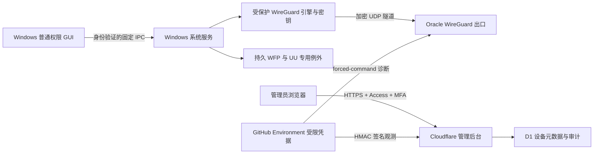

# Oracle Proxy 产品进展与交付约定

核查日期：2026-10-20（Asia/Shanghai）。核查基线：`255123f9ae5bc6adbc1bbdb635a28638061e59da`。

## 结论

项目已有可复用的独立 WireGuard 引擎、Windows GUI、LocalSystem 管理服务、安全边界和大量云端实验。
目前尚未达到「可替换 FlClash 的完整 Windows VPN 产品」状态。
GitHub 没有正式 Release。当前可下载的 Windows R114 是未签名实验便携包，
不能以既有云端实验替代生产防泄漏、开机恢复、UU 连续性或端到端公网出口验收。

本次新增 Cloudflare 管理后台首版、D1 审计和 GitHub→Oracle 只读状态转发链路；
没有接管现有 Windows 连接，也没有修改 Oracle 的 wg0、生产 Peer、路由或防火墙。
后台部署所需的 Cloudflare 身份与账号授权尚未配置。

## 用户已确认

- 主控 Windows 11 x64；受控 Windows 10 x64。
- 需要兼容网易 UU 远程，具备本地可恢复的测试电脑。
- 优先在云端做完所有可自动化测试，实机只做无法由云端证明的最终验收。
- Cloudflare 已托管 `morandi.dpdns.org`，账号使用 GitHub 登录。
- 拟用后台域名 `vpn-admin.morandi.dpdns.org`，管理员邮箱 `morandi@nuaa.edu.cn`。

Cloudflare 账号登录与产品后台登录相互独立；后台使用 Access 验证的 IdP 身份和邮箱白名单。
若要求后台直接用 GitHub OAuth，还需确认 IdP 集成方案，本版没有假装实现 GitHub OAuth。

## 从源码与日志得到的实际进展

| 模块 | 已存在的实现/证据 | 尚缺的最终条件 |
| --- | --- | --- |
| Windows 便携 GUI | R114 自包含 x64 程序、离线 X25519 密钥生成、集成 tunnel.dll 与签名 WireGuardNT DLL | FlClash 风格完整界面、延迟/流量真实遥测、稳定用户连接流程 |
| 独立 WireGuard | `wg-alpha/EmbeddedWireGuardBridge.cs` 集成官方 MIT 隧道库，日常不依赖官方 GUI | 与产品级认证 IPC、持久保护、密钥存储和升级机制整合 |
| 系统服务 | `manager` 有身份验证、固定动词、LocalSystem 与多个 CI 安全实验 | 默认生产内核仍是 `UnavailableProductionKernel`，不能用开关绕过 |
| 防泄漏 | WFP IPv4/IPv6、TCP/UDP/DNS、崩溃与恢复的多项隔离实验 | 持久/开机保护、多网卡、真实重启、独立抓包及完整状态机整体验收 |
| UU | 有连续性证据门禁 | 网易 UU 在两种 Windows 上的真实长连接、重连和例外策略验收 |
| Oracle | 已部署受限只读 Agent；日志确认 wg0 ACTIVE、接口 PRESENT、UDP51820 LISTENING | 握手、Peer 清单、用量与受限配置执行器，IPv6 公网出口能力核实 |
| 网页后台 | 本次新增 Access 身份验证、服务状态、过期提示、D1 审计、HMAC 上报、CI/部署流程 | 真实账号部署、Peer 管理、用量采集与配置回滚接口 |
| 安装和升级 | 部分生命周期与回滚实验、来源校验 | 发布者签名、受保护服务安装、升级事务、卸载/重启恢复与密钥迁移 |

Oracle 部署实证：[Actions 39415011683](https://github.com/Morandi-official/Oracle-Proxy-Infrastructure/actions/runs/39415011683)。
日志为 `deploy-agent`，包含 `AGENT_DEPLOY=OK`、上述三项服务诊断和 `PRODUCTION_NETWORK_CHANGED=NO`。
这是 2026-10-20 19:27 左右的历史观测，不代表阅读本文时仍在线。

Windows 最近成功 R114 构建：
[Actions 39218330880](https://github.com/Morandi-official/Oracle-Proxy-Infrastructure/actions/runs/39218330880)，
源码 `464ad5cd79ccd6c2ff7df8fe98ee075479141120`。
[下载实验便携包](https://github.com/Morandi-official/Oracle-Proxy-Infrastructure/actions/runs/39218330880/artifacts/12169974965)。
Artifact 名称 `OracleProxy-R114-Offline-Keys-Single-Extraction-UNSIGNED`；
72,167,834 字节；归档元数据 SHA256 为
`e066904b08dfaed56f78f574250a7c2e0957aad6dcf11895bc4bb579d41cf3f9`。
该哈希来自 GitHub 元数据，本次未独立下载全部归档并逐字节复核。
按当前 GitHub 元数据将于 2026-10-26 15:50（中国时间）过期，届时应重新构建，不能当永久下载地址。

## 最终产品架构

Windows GUI 只发送固定动作与配置标识；服务从受保护存储读取配置和密钥，
不接收 GUI 提供的任意命令、脚本、服务名或文件路径。服务端管理面不承载 VPN 数据。
Cloudflare 普通 HTTP/CDN 不能转发该 WireGuard UDP 出口流量，Windows 的 WireGuard Endpoint 直达 Oracle。

### 流量与保护约定

1. 日常连接由普通权限 GUI 操作，首次安装服务/驱动和卸载需要 UAC。
   「便携包」是分发形式，不代表系统 VPN 可以完全免安装或免提权。
2. 安全模式下先建立独立于 GUI 生存期的 WFP 防护，再启动隧道；握手和探测成功后显示已连接。
   异常断开保持防护，不能把超时自动解释为允许直连。
3. 显式断开与故障分开：界面需要明确选择「断开且继续阻断」或「关闭保护并恢复直连」。
   服务仅在确认本产品隧道已停止、路由/DNS 已恢复后执行后者。
4. TCP、UDP、IPv4、IPv6 和系统 DNS 均需覆盖，含多网卡、热点、睡眠恢复、DHCP 和网卡变化。
   Oracle IPv6 公网出口未经验证；若不可用，必须阻断 IPv6 防止泄漏，并明确不宣称已支持 IPv6 出口。
5. UU 为明确的直连例外。应根据实际签名程序、子进程及 relay/直连行为制定规则，
   不能通过宽泛 IP 或任意应用直连放行。其直连是声明的产品策略。
6. Windows 私钥在本机生成、由 SYSTEM 受保护存储持有，不上传后台。
   R114 当前是受 ACL 限制的明文测试私钥，不能冒充最终的服务端密钥保护机制。

## 后台当前交付范围

目录 `server/admin-cloudflare/` 是可以构建和部署的 Worker/D1 应用，含真实接口和中文界面。
默认没有演示在线设备或模拟流量；无报告显示未知，报告超过 180 秒显示过期。
报告入口签名时效 300 秒，限制字段和大小，唯一 ID 防重放，原子写入状态与审计。
浏览器只能查询；Peer、流量和配置修改显示未接入。

部署指南和精确 GitHub Environment 配置见
[管理后台 README](../server/admin-cloudflare/README.md)。
三个新工作流分别负责云端验证、Cloudflare 部署、只读 Oracle 状态转发。
生产部署/转发使用 main 分支和独立 Environment；本版不默认开启周期任务。

Peer/端口写入需要后续 Oracle 固定权限执行器，建议事务：
创建带版本的变更请求 → 校验白名单/端口/地址冲突 → 生成只属于本产品的配置 →
保存已知正常版本 → 应用 → 独立连通性探测 → 超时自动回滚 → 审计结果。
不能把现有受限 CI SSH 密钥扩大成后台任意 root shell。

## 云端优先的验收顺序

| 顺序 | 云端可完成 | 必须补充的外部证据 |
| --- | --- | --- |
| 1 | Windows 编译、离线密钥向量与 ACL、IPC 越权、固定命令边界、包内凭据扫描 | 发布者代码签名身份 |
| 2 | 隔离 Windows 的真实 WireGuard/WFP、UDP/TCP/DNS、服务崩溃恢复与精确清理 | 启动前防护与真实系统重启，不能用进程重启替代 |
| 3 | Oracle 受限诊断、独立 Peer 的跨公网握手和出口探测、管理后台身份/审计/回滚 | 授权的测试 Peer 与可回滚服务器配置；先核实 IPv6 能力 |
| 4 | Cloudflare Worker/D1 集成、JWT 错误矩阵、HMAC 重放和过期检查 | 实际 Cloudflare Access/IdP/MFA 与域名部署 |
| 5 | 已有实验不能证明真实用户侧的 ISP/NAT/UU 行为 | Win11/Win10 本地可恢复电脑上的网易 UU、长连接、断网/重启验收 |

完整上线前还需验证签名安装/升级/卸载中断、密钥迁移失败、配置错误和版本回滚。
最终 Windows 构建应生成自己的版本号、校验和、依赖许可证、构建来源和可供复核的测试报告。

## 本次完成的验证

- Node 安全和状态测试：12 项通过。
- Python 采集器和部署配置测试：4 项通过。
- workerd/Miniflare：实际打包 Worker + 本地 D1 的上报、重放回滚及未认证拒绝集成测试通过。
- Wrangler Worker 和三份静态资源 dry-run 构建通过；不代表账号已部署。
- 仓库既有 release 门禁测试：50 项通过。
- 新增工作流 YAML 解析通过；依赖审计在本次查询时无已报告漏洞。
- 当前工具没有浏览器控制能力，未声称完成视觉截图或真实浏览器登录验收。

## 当前阻塞与下一步

当前环境没有 Cloudflare 账号凭据、Access 应用参数或 D1 ID；工具目录搜索没有返回 Cloudflare 插件。
因此不能声称管理域名已经上线。
GitHub 连接器可以读写该仓库，但本地 gh 的现有令牌不可用；不读取或导出仓库 Secrets。
已有 Oracle SSH Secrets 应继续留在 GitHub Environment，由 Actions 使用。

需要账号所有者完成的是一次性 Cloudflare/IdP 配置和 GitHub Secret 绑定，而不是日常手动 SSH。
收到这些配置后，继续运行部署/转发验收，再实现经审核的 Peer 与配置事务执行器，
并把 Windows 实验模块收敛为可安装、可恢复的单一产品。当前不应把只读后台或 R114 包标为最终成品。
